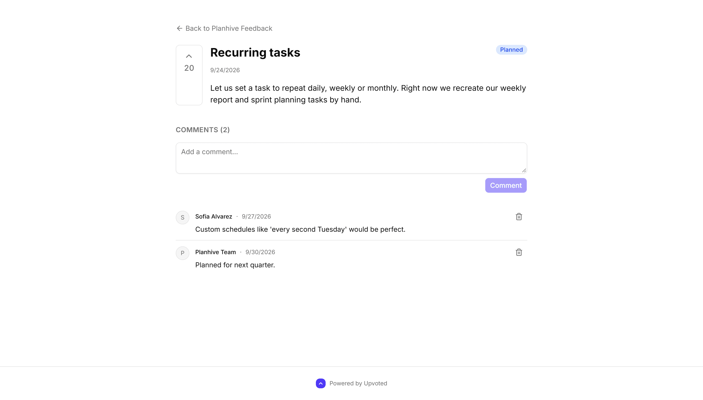
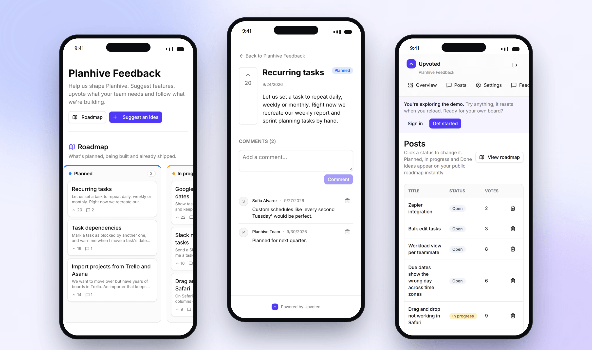
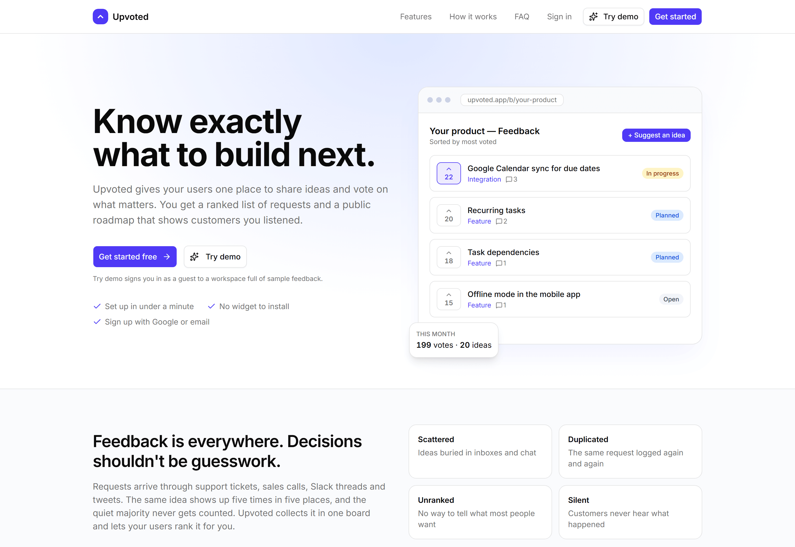
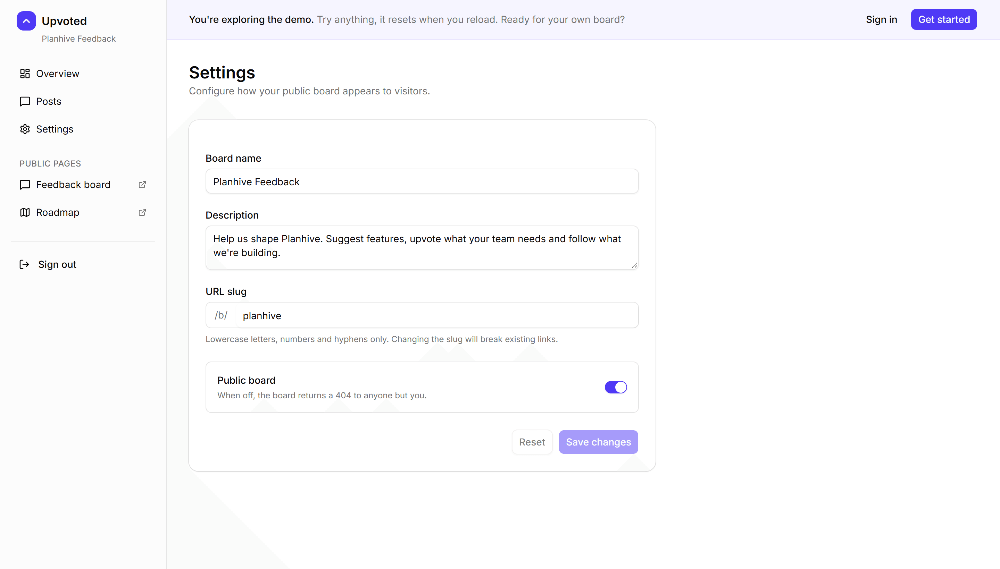
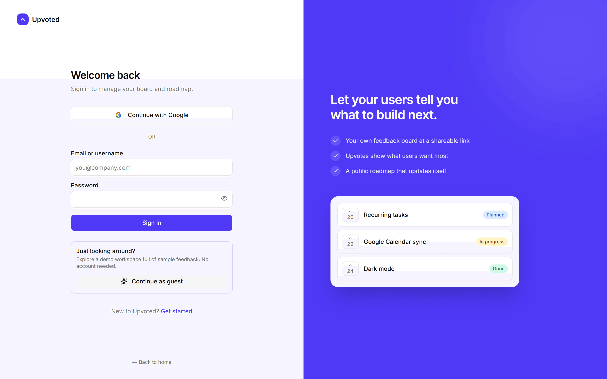
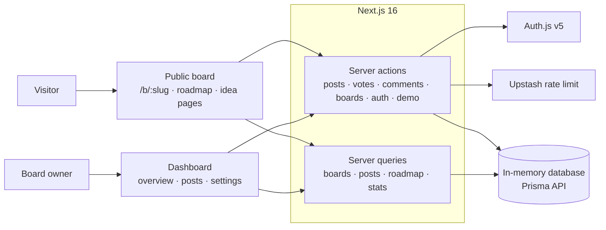

<div align="center">


# Upvoted

**Feedback boards and public roadmaps for product teams.**
Your users suggest ideas and vote on them. You get a ranked list of requests and a roadmap that shows customers you listened.


[](https://upvoted.arealjagema.com)

[Features](#features) · [Design](#design) · [Screenshots](#screenshots) · [Tech stack](#tech-stack) · [Getting started](#getting-started)

</div>


> **This is the `demo` branch**, the portfolio build behind [upvoted.arealjagema.com](https://upvoted.arealjagema.com). It runs without a database: Prisma calls go to an in-memory store seeded with the demo workspace, so it deploys to Netlify with a single secret. The full app with PostgreSQL lives on [`main`](https://github.com/Areal-G/upvoted).

## Overview

Each workspace gets a public board at `/b/<slug>`. Visitors sign in, suggest ideas, upvote the ones they want and discuss them in comments. The team works from a dashboard: it sees what is most requested and moves ideas through **Open → Planned → In progress → Done** (or **Rejected**). Planned, in-progress and done ideas show up on the public roadmap straight away, both on the board and on a full roadmap page.

It is a single Next.js project with server actions and Prisma. On this branch the Prisma client is replaced by an in-memory database, so there is nothing to provision.

## Try the demo

Open [upvoted.arealjagema.com](https://upvoted.arealjagema.com), or run it locally (see [Getting started](#getting-started)), and click **Try demo** on the landing page. You are signed in as a guest to *Planhive Feedback*, a sample workspace with 20 ideas, 245 votes and 22 comments. A banner reminds you that it is a demo. The workspace resets each time a demo starts and when you reload the page, so you can change anything.

Sign-up is turned off here because accounts can't outlive a server instance: `/signup` sends you to the sign-in page.

## Features

### A public board with the roadmap on top

Roadmap columns sit above the feedback list (and swipe sideways on phones). Below them, ideas can be filtered by status and sorted by newest or most voted. Upvotes are one click and update instantly. (Shown in the header image above.)

### Ideas with a conversation

Every idea has its own page with its status, vote count and a comment thread. Authors stay anonymous on the board, and the board owner can remove comments.



### A dashboard that ranks the requests

Totals for posts, votes and comments, a breakdown of posts by status and the top-voted ideas, so the next thing to build is obvious.


### One-click triage

The posts table lists every idea with its votes and comments. Click a status to change it or delete spam, and the public board and roadmap update immediately.


### Everything else

| Area | What you get |
|---|---|
| Roadmap page | `/b/<slug>/roadmap` with Planned, In progress and Done columns |
| Board settings | Name, description, slug, and public or private visibility (private boards return 404) |
| Accounts | Email and password (scrypt-hashed) and Google sign-in through Auth.js v5 |
| Authorization | Every server action checks the session and board ownership before writing |
| Validation | zod schemas on every input |
| Rate limits | Upstash limits on creating posts and on voting; they do nothing when unconfigured locally |
| Demo mode | Guest sign-in, a demo banner and a reset on every new demo or reload |

## Design

- **Light, quiet and content-first.** White surfaces, thin borders and Inter, so the ideas themselves carry the page.
- **One accent.** A single indigo (`oklch(0.511 0.262 276.966)`, about `#4f39f6`) marks primary actions, the active vote and the logo, built on shadcn/ui tokens.
- **Status colours mean the same thing everywhere.** Blue for Planned, amber for In progress, green for Done, on the board columns, badges and dashboard.
- **The logo is the product's main gesture:** an upvote chevron on an indigo tile.

The app is light-only for now; dark mode is on the roadmap.

### On mobile

Both sides work on phones. On the public board the roadmap columns become a horizontal swipe, and voting and commenting stay one tap away. In the dashboard the sidebar becomes a top bar, so the owner can triage from a phone.



## Screenshots

<table>
  <tr>
    <td width="50%"><br><b>Landing page</b> with the one-click demo</td>
    <td width="50%"><br><b>Roadmap</b>: what's planned, in progress and shipped</td>
  </tr>
  <tr>
    <td width="50%"><br><b>Settings</b>: name, slug and visibility</td>
    <td width="50%"><br><b>Sign in</b> with email or Google</td>
  </tr>
</table>

## Tech stack

| Layer | Technology | Why |
|---|---|---|
| Framework | Next.js 16 (App Router, Server Actions), React 19.2 | Server Components for reads, server actions for writes, no separate API layer |
| Language | TypeScript | Shared types from the Prisma schema to the UI |
| UI | Tailwind CSS 4, shadcn/ui (Radix), lucide-react, sonner | Accessible primitives with a small, consistent token set |
| Database | In-memory Prisma client built from the Prisma 7 schema | The same queries as `main`, with no database to host for a demo |
| Auth | Auth.js v5 with JWT sessions and a guest sign-in | One `auth()` call in every action, no session storage needed |
| Validation | zod | One schema per action input |
| Rate limiting | Upstash Ratelimit and Redis (optional) | Stops vote and post spam in production, no-op locally |
| Tests | Vitest | Unit tests for every action, the in-memory database and the demo seed |
| Hosting | Netlify | `netlify.toml` builds it; only `AUTH_SECRET` is needed |

## Architecture



- **Reads and writes are split.** `server/queries/*` are read-only loaders for Server Components. `server/actions/*` are the only way to change data.
- **Data model:** `User`, `Board` (slug, visibility), `Post` (status enum), `Vote` (unique per user and post), `Category`, `Comment`, plus the Auth.js `Account`, `Session` and `VerificationToken` tables.
- **The in-memory database** (`lib/memory-db/`) implements the Prisma calls the app makes (filters, `select`/`include`, `_count`, relation ordering, `groupBy`, unique constraints and `onDelete` rules), driven by the schema's datamodel. A small Prisma generator writes that datamodel to JSON on `prisma generate`.
- **The demo workspace** is seeded from fixtures in `lib/demo/` when a server instance starts. IDs come from counters, so every instance holds identical data. Starting a demo and reloading the page restore it.

## Engineering highlights

### Every write follows the same five steps

Each server action validates, authenticates, rate-limits, checks access, then writes and revalidates the pages that show the data. Voting is a toggle backed by a unique `(postId, userId)` index, so a user can never vote twice.

```ts
// server/actions/votes.ts
export async function toggleVote(input: ToggleVoteInput) {
  const parsed = toggleVoteSchema.safeParse(input);
  if (!parsed.success) return { ok: false, error: "Invalid input" };

  const session = await auth();
  if (!session?.user?.id) return { ok: false, error: "Unauthorized" };

  const { success } = await toggleVoteLimiter.limit(session.user.id);
  if (!success) return { ok: false, error: "Too many requests" };

  const post = await db.post.findUnique({
    where: { id: parsed.data.postId },
    select: { id: true, board: { select: { slug: true, isPublic: true } } },
  });
  if (!post || !post.board.isPublic) return { ok: false, error: "Post not found" };

  const existing = await db.vote.findUnique({
    where: { postId_userId: { postId: post.id, userId: session.user.id } },
  });
  if (existing) await db.vote.delete({ where: { id: existing.id } });
  else await db.vote.create({ data: { postId: post.id, userId: session.user.id } });

  const voteCount = await db.vote.count({ where: { postId: post.id } });
  revalidatePath(`/b/${post.board.slug}`);
  revalidatePath(`/b/${post.board.slug}/posts/${post.id}`);
  return { ok: true, data: { hasVoted: !existing, voteCount } };
}
```

### Votes that feel instant

The vote button uses React 19's `useOptimistic`: the count changes on click, and if the server says no (rate limit, private board) the button shows a toast and refreshes back to the real number.

```tsx
// components/posts/vote-button.tsx
const [optimistic, setOptimistic] = useOptimistic(
  { voteCount, hasVoted },
  (state, nextHasVoted: boolean) => ({
    voteCount: state.voteCount + (nextHasVoted ? 1 : -1),
    hasVoted: nextHasVoted,
  }),
);

function handleClick() {
  startTransition(async () => {
    setOptimistic(!optimistic.hasVoted);
    const result = await toggleVote({ postId });
    if (!result.ok) {
      toast.error(result.error);
      router.refresh();
    }
  });
}
```

## Getting started

### Prerequisites

- Node.js 22 and npm. No database.

### Install and run

```bash
git clone -b demo <your-fork-url> upvoted
cd upvoted
cp .env.example .env.local   # set AUTH_SECRET
npm install                  # also generates the Prisma client and datamodel
npm run dev                  # http://localhost:3000, then click Try demo
```

<details>
<summary><b>Environment variables</b></summary>

| Variable | Required | Description |
|---|---|---|
| `AUTH_SECRET` | Yes | Auth.js secret (`openssl rand -base64 32`) |
| `NEXT_PUBLIC_APP_URL` | No | Public base URL used in metadata and the sitemap; `netlify.toml` sets it for the live demo |
| `AUTH_GOOGLE_ID`, `AUTH_GOOGLE_SECRET` | No | Leave blank: Google accounts can't persist without a database, and the button then explains that it is not configured |
| `UPSTASH_REDIS_REST_URL`, `UPSTASH_REDIS_REST_TOKEN` | No | Rate limiting; does nothing when blank |

</details>

<details>
<summary><b>Scripts</b></summary>

| Script | What it does |
|---|---|
| `npm run dev` / `build` / `start` | Development server, production build, production server |
| `npm run lint` / `typecheck` | ESLint / `tsc --noEmit` |
| `npm test` / `test:watch` | Vitest |
| `npm run db:generate` | Regenerate the Prisma client and the in-memory datamodel |

</details>

<details>
<summary><b>Project structure</b></summary>

```
app/
├── (auth)/           login (signup redirects to it)
├── (dashboard)/      dashboard overview, posts, settings
├── b/[slug]/         public board, idea pages, roadmap
├── api/              Auth.js, board visibility
└── page.tsx          landing page
components/           UI (shadcn/ui), board, dashboard and demo components
lib/                  in-memory database, validators, rate limits, password hashing, demo seed
server/
├── actions/          mutations (posts, votes, comments, boards, auth, demo) + tests
└── queries/          read models (boards, posts, roadmap, stats)
prisma/               schema (the datamodel for the in-memory database)
```

</details>

## Testing and quality

```bash
npm run typecheck
npm test
```

- The Vitest suites cover the server actions for boards, posts (create, status, edit, delete), votes and comments, including validation, rate limits and ownership checks.
- The in-memory database has its own suite (defaults, unique and foreign keys, filters, ordering, `_count`, cascades, `groupBy`, transactions), and the seed test checks that two instances build identical IDs.
- The Playwright end-to-end specs need PostgreSQL, so they live on `main`.

## Deployment

Deploy this branch to Netlify:

1. Create a site from the repository with `demo` as the production branch. `netlify.toml` sets the build command, Node 22 and `NEXT_PUBLIC_APP_URL`; change that URL if you use another domain.
2. Set `AUTH_SECRET` under Site configuration → Environment variables. Nothing else is required.

Each serverless instance seeds its own copy of the demo workspace, so changes a visitor makes stay on the instance that served them and disappear when it is recycled.

## Roadmap

- Dark mode.
- Email notifications when an idea you voted for changes status.
- Several boards per account, and team members with shared moderation.
- Merge duplicate ideas and combine their votes.
- An embeddable widget and a public API.