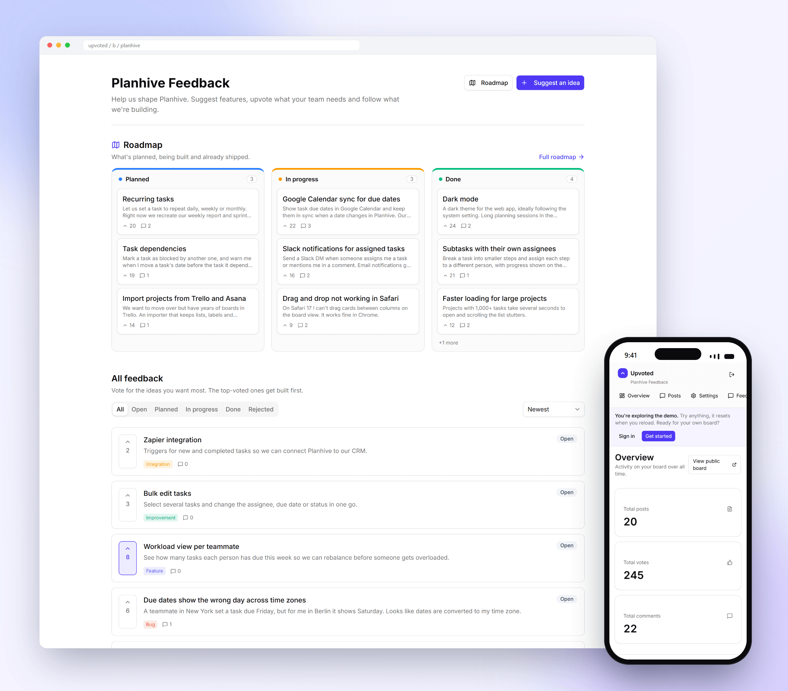
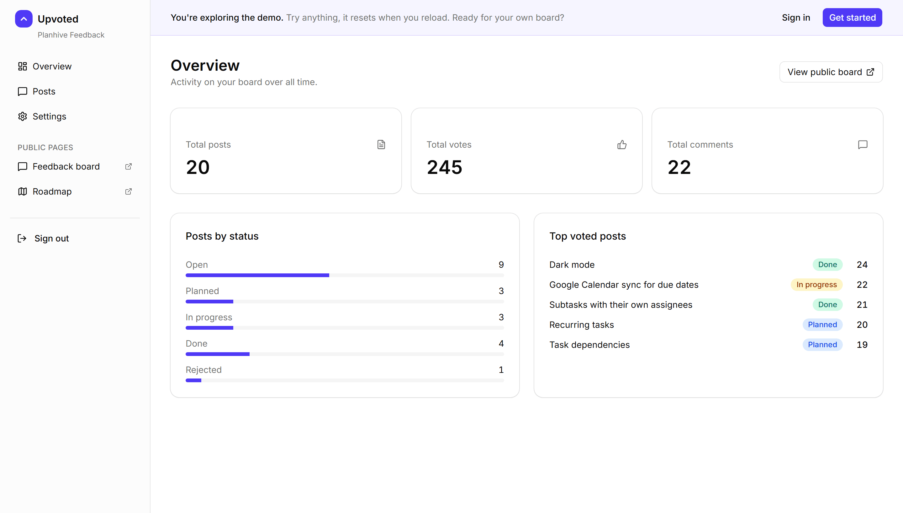
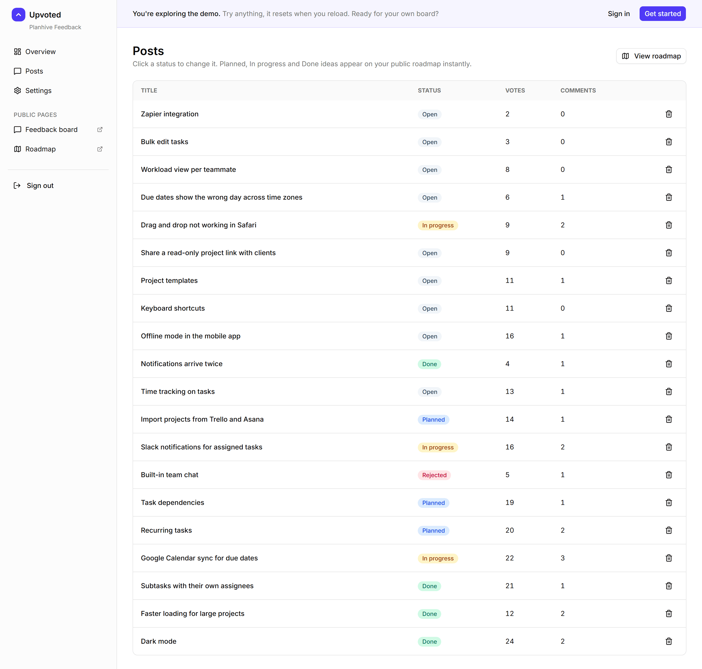
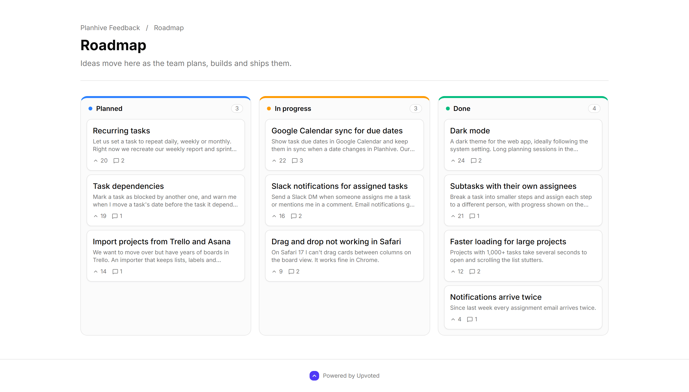
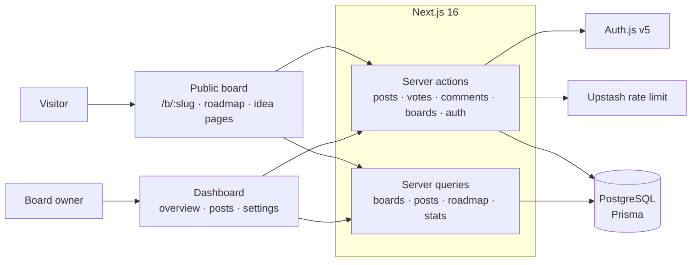

<div align="center">


# Upvoted

**Feedback boards and public roadmaps for product teams.**
Your users suggest ideas and vote on them. You get a ranked list of requests and a roadmap that shows customers you listened.


[](https://upvoted.arealjagema.com)

[Features](#features) · [Design](#design) · [Screenshots](#screenshots) · [Tech stack](#tech-stack) · [Getting started](#getting-started)

</div>



## Overview

Each workspace gets a public board at `/b/<slug>`. Visitors sign in, suggest ideas, upvote the ones they want and discuss them in comments. The team works from a dashboard: it sees what is most requested and moves ideas through **Open → Planned → In progress → Done** (or **Rejected**). Planned, in-progress and done ideas show up on the public roadmap straight away, both on the board and on a full roadmap page.

It is a single Next.js project with server actions, Prisma and PostgreSQL, and it deploys to Vercel as is.

## Live demo

Try it at **[upvoted.arealjagema.com](https://upvoted.arealjagema.com)**: click **Try demo** to explore *Planhive Feedback*, a sample workspace with 20 ideas, 245 votes and 22 comments. The demo runs from the [`demo`](https://github.com/Areal-G/upvoted/tree/demo) branch, which keeps its data in memory and needs no database.

This branch is the full app. To run your own board, create an account at `/signup` (username, email and password, or Google), or load the same sample workspace locally with `npm run seed`.

## Features

### A public board with the roadmap on top

Roadmap columns sit above the feedback list (and swipe sideways on phones). Below them, ideas can be filtered by status and sorted by newest or most voted. Upvotes are one click and update instantly. (Shown in the header image above.)

### Ideas with a conversation

Every idea has its own page with its status, vote count and a comment thread. Authors stay anonymous on the board, and the board owner can remove comments.


### A dashboard that ranks the requests

Totals for posts, votes and comments, a breakdown of posts by status and the top-voted ideas, so the next thing to build is obvious.



### One-click triage

The posts table lists every idea with its votes and comments. Click a status to change it or delete spam, and the public board and roadmap update immediately.



### Everything else

| Area | What you get |
|---|---|
| Roadmap page | `/b/<slug>/roadmap` with Planned, In progress and Done columns |
| Board settings | Name, description, slug, and public or private visibility (private boards return 404) |
| Accounts | Email and password (scrypt-hashed) and Google sign-in through Auth.js v5 |
| Authorization | Every server action checks the session and board ownership before writing |
| Validation | zod schemas on every input |
| Rate limits | Upstash limits on creating posts and on voting; they do nothing when unconfigured locally |
| Sample data | `npm run seed` loads a sample board and an owner account you can sign in with |

## Design

- **Light, quiet and content-first.** White surfaces, thin borders and Inter, so the ideas themselves carry the page.
- **One accent.** A single indigo (`oklch(0.511 0.262 276.966)`, about `#4f39f6`) marks primary actions, the active vote and the logo, built on shadcn/ui tokens.
- **Status colours mean the same thing everywhere.** Blue for Planned, amber for In progress, green for Done, on the board columns, badges and dashboard.
- **The logo is the product's main gesture:** an upvote chevron on an indigo tile.

The app is light-only for now; dark mode is on the roadmap.

### On mobile

Both sides work on phones. On the public board the roadmap columns become a horizontal swipe, and voting and commenting stay one tap away. In the dashboard the sidebar becomes a top bar, so the owner can triage from a phone.


## Screenshots

<table>
  <tr>
    <td width="50%"><br><b>Landing page</b></td>
    <td width="50%"><br><b>Roadmap</b>: what's planned, in progress and shipped</td>
  </tr>
  <tr>
    <td width="50%"><br><b>Settings</b>: name, slug and visibility</td>
    <td width="50%"><br><b>Sign in</b> with email or Google</td>
  </tr>
</table>

## Tech stack

| Layer | Technology | Why |
|---|---|---|
| Framework | Next.js 16 (App Router, Server Actions), React 19.2 | Server Components for reads, server actions for writes, no separate API layer |
| Language | TypeScript | Shared types from the Prisma schema to the UI |
| UI | Tailwind CSS 4, shadcn/ui (Radix), lucide-react, sonner | Accessible primitives with a small, consistent token set |
| Database | PostgreSQL with Prisma 7 (`@prisma/adapter-pg`) | Relational data (boards, posts, votes) with a unique vote per user and post |
| Auth | Auth.js v5 with the Prisma adapter: credentials and Google | Sessions in the same database, one `auth()` call in every action |
| Validation | zod | One schema per action input |
| Rate limiting | Upstash Ratelimit and Redis (optional) | Stops vote and post spam in production, no-op locally |
| Tests | Vitest, Playwright | Unit tests for every action, end-to-end tests for the main flows |
| Hosting | Vercel | Zero-config deploy |

## Architecture



- **Reads and writes are split.** `server/queries/*` are read-only loaders for Server Components. `server/actions/*` are the only way to change data.
- **Data model:** `User`, `Board` (slug, visibility), `Post` (status enum), `Vote` (unique per user and post), `Category`, `Comment`, plus the Auth.js `Account`, `Session` and `VerificationToken` tables.
- **Sample data** lives in `prisma/seed/`. `npm run seed` rebuilds the sample workspace and is safe to re-run.

## Engineering highlights

### Every write follows the same five steps

Each server action validates, authenticates, rate-limits, checks access, then writes and revalidates the pages that show the data. Voting is a toggle backed by a unique `(postId, userId)` index, so a user can never vote twice.

```ts
// server/actions/votes.ts
export async function toggleVote(input: ToggleVoteInput) {
  const parsed = toggleVoteSchema.safeParse(input);
  if (!parsed.success) return { ok: false, error: "Invalid input" };

  const session = await auth();
  if (!session?.user?.id) return { ok: false, error: "Unauthorized" };

  const { success } = await toggleVoteLimiter.limit(session.user.id);
  if (!success) return { ok: false, error: "Too many requests" };

  const post = await db.post.findUnique({
    where: { id: parsed.data.postId },
    select: { id: true, board: { select: { slug: true, isPublic: true } } },
  });
  if (!post || !post.board.isPublic) return { ok: false, error: "Post not found" };

  const existing = await db.vote.findUnique({
    where: { postId_userId: { postId: post.id, userId: session.user.id } },
  });
  if (existing) await db.vote.delete({ where: { id: existing.id } });
  else await db.vote.create({ data: { postId: post.id, userId: session.user.id } });

  const voteCount = await db.vote.count({ where: { postId: post.id } });
  revalidatePath(`/b/${post.board.slug}`);
  revalidatePath(`/b/${post.board.slug}/posts/${post.id}`);
  return { ok: true, data: { hasVoted: !existing, voteCount } };
}
```

### Votes that feel instant

The vote button uses React 19's `useOptimistic`: the count changes on click, and if the server says no (rate limit, private board) the button shows a toast and refreshes back to the real number.

```tsx
// components/posts/vote-button.tsx
const [optimistic, setOptimistic] = useOptimistic(
  { voteCount, hasVoted },
  (state, nextHasVoted: boolean) => ({
    voteCount: state.voteCount + (nextHasVoted ? 1 : -1),
    hasVoted: nextHasVoted,
  }),
);

function handleClick() {
  startTransition(async () => {
    setOptimistic(!optimistic.hasVoted);
    const result = await toggleVote({ postId });
    if (!result.ok) {
      toast.error(result.error);
      router.refresh();
    }
  });
}
```

## Getting started

### Prerequisites

- Node.js 20+ and npm
- PostgreSQL (Docker is the easiest way)

### Install and run

```bash
git clone <your-fork-url> upvoted
cd upvoted
cp .env.example .env
docker run -d --name upvoted-pg -e POSTGRES_USER=upvoted \
  -e POSTGRES_PASSWORD=upvoted -e POSTGRES_DB=upvoted -p 5432:5432 postgres:17-alpine
npm install
npx prisma migrate deploy
npm run seed           # optional: loads the sample workspace
npm run dev            # http://localhost:3000
```

Prisma and the seed script read `.env`, not `.env.local`. The seed prints the sample board owner's email; the password is `SEED_OWNER_PASSWORD`, or the local-only default in `prisma/seed/config.ts`.

<details>
<summary><b>Environment variables</b></summary>

| Variable | Required | Description |
|---|---|---|
| `DATABASE_URL` | Yes | PostgreSQL connection string |
| `AUTH_SECRET` | Yes | Auth.js secret (`openssl rand -base64 32`) |
| `AUTH_URL`, `AUTH_TRUST_HOST` | Yes | Public URL, and trust the host header behind a proxy |
| `NEXT_PUBLIC_APP_URL` | Yes | Public base URL used in links |
| `DIRECT_URL` | No | Direct database connection for migrations when `DATABASE_URL` is pooled |
| `AUTH_GOOGLE_ID`, `AUTH_GOOGLE_SECRET` | No | Google sign-in. Redirect URI: `<url>/api/auth/callback/google` |
| `UPSTASH_REDIS_REST_URL`, `UPSTASH_REDIS_REST_TOKEN` | Production | Rate limiting; does nothing when blank |
| `SEED_OWNER_EMAIL`, `SEED_OWNER_PASSWORD` | No | Sign-in for the owner created by `npm run seed`; defaults are for local use only |
| `E2E_TEST_MODE` | Tests only | Enables the passwordless login used by Playwright |

</details>

<details>
<summary><b>Scripts</b></summary>

| Script | What it does |
|---|---|
| `npm run dev` / `build` / `start` | Development server, production build, production server |
| `npm run lint` / `typecheck` | ESLint / `tsc --noEmit` |
| `npm test` / `test:watch` | Vitest |
| `npm run test:e2e` / `test:e2e:ui` | Playwright (uses `.env.test`) |
| `npm run db:migrate` / `db:push` / `db:reset` | Prisma migrations |
| `npm run seed` | Load the sample workspace |
| `npm run db:studio` / `db:generate` | Prisma Studio / regenerate the client |

</details>

<details>
<summary><b>Project structure</b></summary>

```
app/
├── (auth)/           login and signup
├── (dashboard)/      dashboard overview, posts, settings
├── b/[slug]/         public board, idea pages, roadmap
├── api/              Auth.js, board visibility
└── page.tsx          landing page
components/           UI (shadcn/ui), auth, board and post components
lib/                  Prisma client, validators, rate limits, password hashing
server/
├── actions/          mutations (posts, votes, comments, boards, auth) + tests
└── queries/          read models (boards, posts, roadmap, stats)
prisma/               schema, migrations, sample-data seed
e2e/                  Playwright specs
```

</details>

## Testing and quality

```bash
npm run typecheck
npm test               # 5 files, 26 tests
npm run test:e2e       # needs a test database in .env.test
```

- The Vitest suites cover the server actions for boards, posts (create, status, edit, delete), votes and comments, including validation, rate limits and ownership checks.
- The Playwright specs cover the happy path (sign in, post, vote, comment), the owner's status changes and deletes, and authorization: guests are redirected to login, non-owners can't open another board's settings, and private boards return 404.

## Deployment

Deploy to Vercel with a managed PostgreSQL database (Neon, Supabase or Vercel Postgres):

1. Set the environment variables above, with `AUTH_URL` and `NEXT_PUBLIC_APP_URL` pointing at your domain.
2. Run `npx prisma migrate deploy` against the production database.
3. Add Upstash Redis for rate limiting.

## Roadmap

- Dark mode.
- Email notifications when an idea you voted for changes status.
- Several boards per account, and team members with shared moderation.
- Merge duplicate ideas and combine their votes.
- An embeddable widget and a public API.